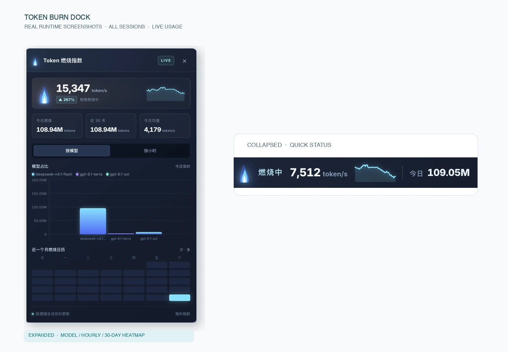
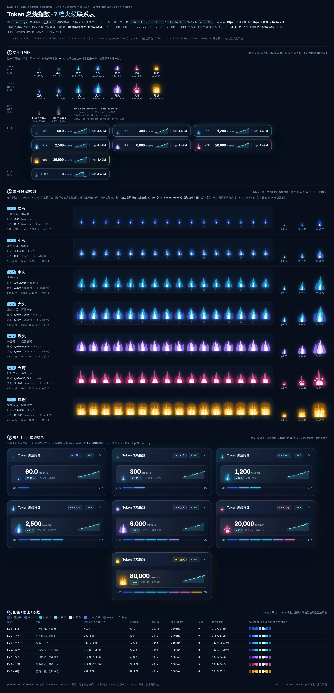

# Token Burn Index · dsh-plugin-token-burned

  



> Expanded panel on the left; the collapsed capsule on the right. A real runtime screenshot, not a mockup.

**Turn tokens into a fire you can see.**

A floating Token Burn Index dock for DeepSeek Harness (DSH): every session's usage folded into one fire you can watch — one glance tells you how hot it is.

[Install](#install) · [7 burn tiers](#burn-tiers) · [Feedback](https://github.com/yuna78/dsh-plugin-token-burned/issues) · [中文](README.md)

## Why install it

- **Know how hot it burns at a glance.** The collapsed capsule shows the current burn tier (星火 → 爆燃), the live `token/s`, a 60-second rate curve and today's total — no expanding, no clicking.
- **Seven tiers, from a single spark to a full fire wall.** Every tier is its own 16-frame procedurally generated SVG with its own palette, glow, flicker speed and tongue layout, growing from one small flame into a full-width wall of fire; all of it is code, with no image assets. With no new burn it settles into a static, desaturated icon.
- **No jitter, no tier-hopping.** It climbs fast (~0.3s) and falls slow (~0.9s), so a wobbly rate keeps the flame steady at its current tier.
- **The detail is there when you want it.** Expand to switch between per-model and per-hour bars with a real left axis whose ticks ease upward as the data max grows, plus a 30-day heatmap and a 7-segment burn-tier progress bar.
- **Numbers you can trust, nothing lost on restart.** Usage is aggregated across every session; days and hours bucket by the browser's timezone; 31 days of records are written atomically so a restart never wipes them.
- **Out of your way.** The dock is draggable and remembers its position; `prefers-reduced-motion` is honored; usage is read locally from DSH and never uploaded.

### Burn tiers

Tiers are picked by **absolute `token/s` cut-offs** — the rate is stable and predictable: around 20k/s is 火海 (Inferno), and only 50k/s and up is 爆燃 (Detonation).

The live rate counts **all provider-usage tokens**: **input + cache read/write + output**. Cache reads usually dominate, so a normal coding session already runs at 10k–30k `token/s` — that is not an anomaly. 7 burning tiers plus `已熄灭`:

| Tier | Live rate (token/s) | Flame | One-liner |
| --- | --- | --- | --- |
| 1 星火 (Spark) | < 100 | single small tongue, slow flicker | 一星火苗，刚点着 — a lone spark, just lit |
| 2 小火 (Low) | 100 – 500 | tongue + inner core | 小火慢烧，稳稳的 — a low, steady burn |
| 3 中火 (Medium) | 500 – 2,000 | twin outer tongues | 火势上来了 — it's building up |
| 4 大火 (High) | 2,000 – 3,000 | three tongue layers + bright inner flame | 三丛火舌，呼呼作响 — three tongues roaring |
| 5 烈火 (Blaze) | 3,000 – 9,000 | wide fire body + many tongues | 一团烈火，烧穿屏幕 — a blaze burning through the screen |
| 6 火海 (Inferno) | 9,000 – 50,000 | three clusters + bottom fire wall + embers | 好多丛火，连成一片 — clusters merging into one |
| 7 爆燃 (Detonation) | ≥ 50,000 | full-width fire wall + many tongues + embers | 整面火墙，全屏爆燃 — the whole screen detonates |

With no new burn it shows `已熄灭` (a static, desaturated icon).



> Generated offline by `npm run preview` from the real `client.js` art layer (no image assets); 19px is the actual capsule size.

> Most of the time you are looking at that 19px flame in the capsule — which is why every tier gets its own 16 frames.

## What's in the panel

Expanded, top to bottom:

- **Hero row**: the large live rate, a chip comparing it to today's average, and a 60-second rate sparkline.
- **Two tabs**: per-model / per-hour; bars sit on a real left axis whose tick labels ease upward as the data max grows, with smoothly transitioning heights.
- **30-day heatmap**: aligned to real weekdays, shaded by relative intensity.
- **7-segment burn-tier progress bar**: the current tier plus that tier's one-line copy.
- **LIVE / OFFLINE status**: whether it is actually burning, stated right on the panel.

## Data

The plugin aggregates observable `assistant/message` provider usage across all sessions. Totals include input, cache read/write, and output tokens. It never fabricates billing data when usage is unavailable.

- **"Today" and "which hour" follow the browser's timezone.** The client passes its UTC offset (`?off=`, minutes) to the host, which buckets days and hours with that fixed offset. A host process running under `TZ=UTC` used to bucket by its own `getHours()`, so bars landed under the wrong hour labels.
- **Persistence is atomic and load-ordered.** State lives in `storages/dsh-token-burned.json` (write `.tmp`, then `rename`), and a write always waits for history to finish loading. The old code could have a restarted process overwrite the file with a Map that held only the newest event, wiping all earlier records.
- Entries are retained for 31 days and aggregated over a 30-day window; anything older is pruned at load time.

## Install

Search for it in the DSH plugin installer:

```text
dsh-plugin-token-burned
```

Refresh the page after installing — no restart needed.

## Development

```bash
npm install
npm test
```

### Backfill usage history

Releases before 0.2.0 lost their state file on every restart, so some history days are missing. You can rebuild them once from the local session transcripts:

```bash
npm run backfill            # report only (dry-run by default)
npm run backfill -- --write # write the baseline file, then restart DSH
```

It only writes `~/.dsh/storages/dsh-token-burned.baseline.json` (~30 numbers, under 1 KB) and never touches the state file; today's numbers always come from live events and are never overwritten by a backfill.

## Releasing

Releases are published manually by a maintainer (no CI publish job). A release = version bump + CHANGELOG + tag + GitHub Release + `npm publish`.

1. **Clean tree**: no uncommitted changes and `npm test` green (`prepublishOnly` re-runs it anyway).
2. **CHANGELOG**: add `## [x.y.z] — YYYY-MM-DD` at the top, grouped as Added / Changed / Fixed.
3. **Bump and tag** (the `v` prefix matches the version):

   ```bash
   npm version patch --no-git-tag-version   # or minor / major
   git add package.json CHANGELOG.md README.md README.en.md
   git commit -m "chore(release): x.y.z"
   git tag -a vx.y.z -m "x.y.z"
   git push && git push --tags
   ```

4. **Check the tarball** (pack only, do not publish yet):

   ```bash
   npm pack --dry-run
   npm pack --pack-destination dist
   ```

   Only the 9 files in the `files` whitelist should be inside (`index.js`, `client.js`, `cordis.patch.yml`, `icon.svg`, `README.md`, `README.en.md`, `CHANGELOG.md`, `LICENSE`, `package.json`) — around 27 kB. `verify/` and the large `docs/` images are git-only.
5. **GitHub Release**: pick tag `vx.y.z` and paste the matching CHANGELOG section. The contact-sheet image in the READMEs loads from `raw.githubusercontent.com/.../main/docs/preview-tiers.webp`, so **push before creating the Release** or the image will 404 on the npm page.
6. **Publish** (npm 2FA required):

   ```bash
   npm publish
   ```

7. **Verify after publish**:

   ```bash
   npm view dsh-plugin-token-burned version dist.tarball
   npm pack dsh-plugin-token-burned@x.y.z --pack-destination /tmp
   tar tzf /tmp/dsh-plugin-token-burned-x.y.z.tgz
   ```

> Published versions are immutable — a mistake needs a new patch release. `prepublishOnly` is bound to `npm test`, so even a forgotten test run is caught by smoke / baseline / tiers before anything is uploaded.

## License

MIT

---

Install it — then, before you log off, see how much you burned today.
