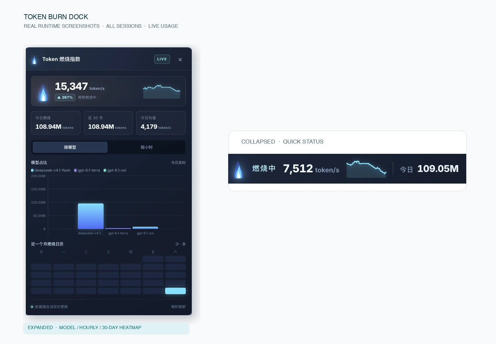
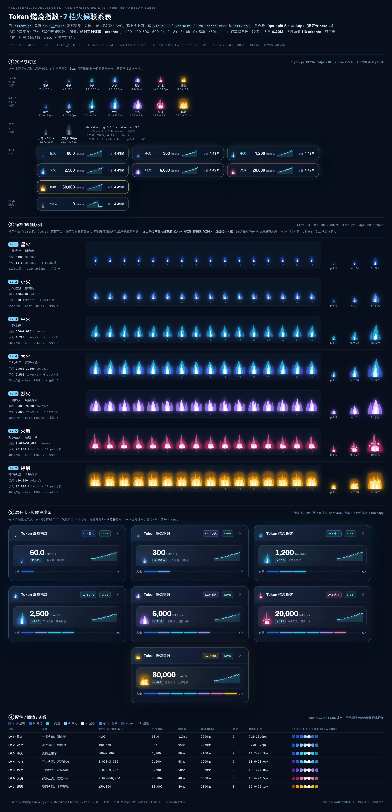

# Token 燃烧指数 · dsh-plugin-token-burned

  



> 左侧是展开面板，右侧是收起后的胶囊。真实运行时截图，不是渲染稿。

**看得见的燃烧。**

DSH 的悬浮 Token 燃烧指数 Dock：把全部 session 的用量汇成一撮会烧的火——烧得多旺，扫一眼就知道。

[安装](#安装) · [7 档火候](#火候档位) · [提交反馈](https://github.com/yuna78/dsh-plugin-token-burned/issues) · [English](README.en.md)

## 为什么值得装

- **一眼知道现在烧得多旺。** 收起胶囊直接显示当前火候档位（星火 → 爆燃）、实时 `token/s`、近 60 秒速率曲线和今日总量——不用展开、不用点开。
- **七档火候，从一撮火苗烧到整面火墙。** 每档都是独立的 16 帧程序生成 SVG，各有配色、发光、闪烁速度与火舌布局，形态随档位从单苗小焰长成满宽火墙；全部由代码绘制，无图片资源。没在烧时，它熄灭成静态灰色图标。
- **不抖、不跳档。** 升档快（约 0.3s）、落档慢（约 0.9s），速率小幅抖动时火焰稳稳停在当前档位。
- **想深挖时，数据都在。** 展开后可按模型 / 按小时切换柱状图，左侧纵轴刻度随数据最大值缓动升高；另有近 30 天热力图与 7 段火候进度条。
- **数字可信，重启不丢。** 跨 session 汇总所有可见 usage；日 / 小时按浏览器时区分桶；31 天记录原子落盘，重启不会清空历史。
- **不打扰你。** Dock 可拖动并记住位置；`prefers-reduced-motion` 下不播放帧；纯本地读取 DSH 用量，不上传任何数据。

### 火候档位

档位直接按**实时速率**（`token/s`）的绝对阈值判定，速率稳定可预期——2 万/s 左右是火海，5 万/s 以上才是爆燃。

实时速率统计的是 provider usage 的**全量 token**：**输入 + 缓存读/写 + 输出**一起算。缓存读通常占大头，所以一次正常编码会话就会跑到 1–3 万 `token/s`，这不是异常。7 档燃烧 + `已熄灭`：

| 档位 | 实时速率（token/s） | 火焰 | 一句文案 |
| --- | --- | --- | --- |
| 1 星火 | < 100 | 单苗小焰，慢闪 | 一星火苗，刚点着 |
| 2 小火 | 100 – 500 | 火苗 + 内芯 | 小火慢烧，稳稳的 |
| 3 中火 | 500 – 2,000 | 双舌外焰 | 火势上来了 |
| 4 大火 | 2,000 – 3,000 | 三层火舌 + 高光内焰 | 三丛火舌，呼呼作响 |
| 5 烈火 | 3,000 – 9,000 | 宽火团 + 多舌 | 一团烈火，烧穿屏幕 |
| 6 火海 | 9,000 – 50,000 | 三簇并列 + 底部火墙 + 余烬 | 好多丛火，连成一片 |
| 7 爆燃 | ≥ 50,000 | 满宽火墙 + 多舌 + 余烬 | 整面火墙，全屏爆燃 |

没有新增燃烧时显示 `已熄灭`（静态灰色图标）。



> 联系表由 `npm run preview` 离线生成，直接调用真实 `client.js` 的绘图层；19px 是胶囊里的真实火焰尺寸（展开面板 34px），无图片资源。

> 绝大多数时间，你看到的就是胶囊里 19px 的那一撮火——所以每一档都单独画了 16 帧。

## 面板里有什么

展开之后：

- **Hero 区**：大号实时速率、相对日均的涨跌 chip、近 60 秒速率 sparkline。
- **两个标签页**：按模型 / 按小时切换；柱状图带真实左侧纵轴刻度，刻度随数据最大值缓动升高，柱体高度平滑过渡。
- **近 30 天热力图**：按真实星期对齐，色阶按相对强度归一。
- **7 段火候进度条**：当前档位，配那一档的一句文案。
- **LIVE / OFFLINE 状态**：正在烧还是已熄灭，面板上直接写清楚。

## 数据说明

统计范围为当前 DSH Host 中可观察到的**全部 session**。数据来自 `assistant/message` 的 provider usage：输入、缓存读写和输出 Token。没有可用 usage 时不会伪造账单数据。

- **"今日"与"某小时"按浏览器时区分桶**：客户端把自身 UTC 偏移（`?off=`，分钟）传给 Host，Host 用固定偏移计算日/小时边界。这样即使 Host 进程跑在 UTC 下，柱子也不会落到错误的小时标签上（历史 bug：Host 用 `getHours()` 按进程时区分桶，与浏览器标签不一致）。
- **持久化是原子的**：状态写入 `storages/dsh-token-burned.json`（先写 `.tmp` 再 `rename`），且**写入前一定等待历史加载完成**。旧实现存在竞态：重启后新进程若先写入，会用仅含最新事件的 Map 覆盖整个文件，导致历史被清空。
- 记录保留 31 天，读取时按 30 天窗口聚合；更早的条目会在加载时清理。

## 安装

在 DSH 的插件安装界面搜索：

```text
dsh-plugin-token-burned
```

装完刷新页面即可，无需重启。

## 开发

```bash
npm install
npm test
```

### 回填历史用量

0.2.0 之前的版本每次重启都会丢状态文件，历史天数因此缺失。可以一次性从本机会话日志里补回来：

```bash
npm run backfill            # 只报告（默认 dry-run）
npm run backfill -- --write # 写基线文件，然后重启 DSH
```

它只写 `~/.dsh/storages/dsh-token-burned.baseline.json`（约 30 个数字，不到 1 KB），不碰状态文件；今天的数据始终来自实时事件，不会被回填覆盖。

## 发版

发布到 npm 由维护者手动执行（没有 CI 自动发布）。一次发版 = 改版本 + 记 CHANGELOG + 打 tag + 发 GitHub Release + `npm publish`。

1. **确认干净**：工作区没有未提交改动，`npm test` 全绿（`prepublishOnly` 也会再跑一遍）。
2. **记 CHANGELOG**：在 `CHANGELOG.md` 顶部新开 `## [x.y.z] — YYYY-MM-DD`，按 Added / Changed / Fixed 写清楚。
3. **bump 版本并打 tag**（tag 带 `v` 前缀，与版本号一致）：

   ```bash
   npm version patch --no-git-tag-version   # 或 minor / major
   git add package.json CHANGELOG.md README.md README.en.md
   git commit -m "chore(release): x.y.z"
   git tag -a vx.y.z -m "x.y.z"
   git push && git push --tags
   ```

4. **打包自检**（只打不发布，确认包内容）：

   ```bash
   npm pack --dry-run
   npm pack --pack-destination dist
   ```

   包内只该有 `files` 白名单里的 9 个文件（`index.js`、`client.js`、`cordis.patch.yml`、`icon.svg`、`README.md`、`README.en.md`、`CHANGELOG.md`、`LICENSE`、`package.json`），约 27 kB；`verify/` 与 `docs/` 下的大图不进包。
5. **发 GitHub Release**：tag 选 `vx.y.z`，正文直接贴 CHANGELOG 的对应小节。README 的联系表图片走 `raw.githubusercontent.com/.../main/docs/preview-tiers.webp`，所以**先 push 再发 Release**，否则 npm 页面上图片会 404。
6. **发布**（需要 npm 2FA）：

   ```bash
   npm publish
   ```

7. **发布后核对**：

   ```bash
   npm view dsh-plugin-token-burned version dist.tarball
   npm pack dsh-plugin-token-burned@x.y.z --pack-destination /tmp
   tar tzf /tmp/dsh-plugin-token-burned-x.y.z.tgz
   ```

> 已发布的版本号不能覆盖，出问题只能再发一个 patch 版。`prepublishOnly` 已绑定 `npm test`，即使忘了手动跑测试，`npm publish` 也会先被 smoke / baseline / tiers 三套测试拦下来。

## License

MIT

---

装一个，下次下班前看看今天烧了多少。
